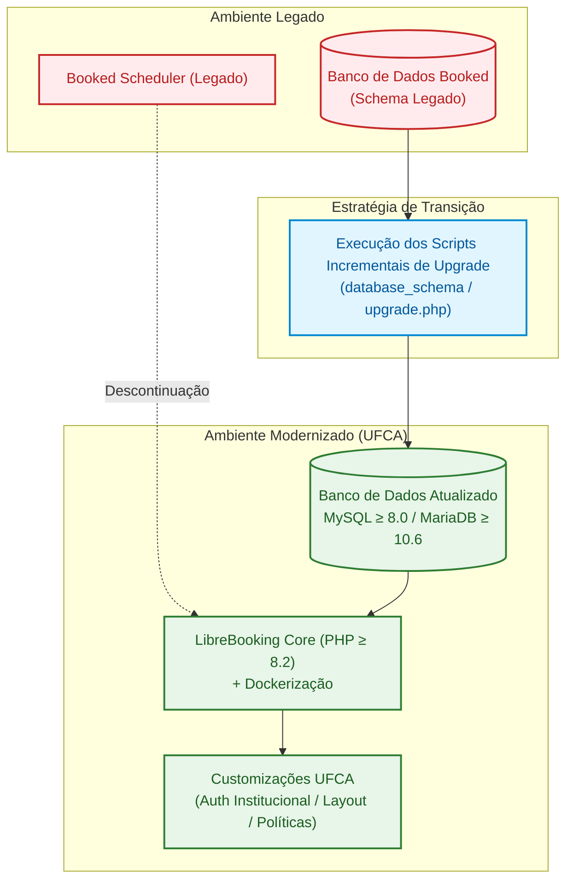

# ADR 0001: Adoção do LibreBooking para Gestão e Agendamento de Recursos na UFCA

| Metadado | Detalhe |
| :--- | :--- |
| **Status** |  |
| **Data da Decisão** | 2024-09-24 |
| **Decisores** | Equipe de Tecnologia da Informação / DTI UFCA |
| **Stakeholders** | Comunidade Acadêmica (Docentes, Discentes e TAEs), Gestores de Espaços Físicos |
| **Tags** | `arquitetura`, `infraestrutura`, `open-source`, `legado`, `migracao`, `ufca` |

---

## 1. Visão Executiva

A Universidade Federal do Cariri (**UFCA**) adota oficialmente o **LibreBooking** (fork *open-source* da plataforma Booked Scheduler) como sua solução institucional padrão para agendamento e reserva de recursos e espaços físicos (salas, laboratórios, auditórios e equipamentos). 

Esta decisão substitui a versão obsoleta do sistema legado **Booked**, garantindo conformidade tecnológica, conformidade orçamentária no serviço público e independência contra *vendor lock-in*.

---

## 2. Contexto e Declaração do Problema

A UFCA possui demanda contínua e descentralizada por gestão de seus espaços acadêmicos e administrativos. Historicamente, a instituição utilizava uma versão legada do **Booked Scheduler**. Contudo, o cenário encontrava-se insustentável devido aos seguintes fatores:

1. **Descontinuidade da Versão Aberta pelo Fabricante Original:** O Booked Scheduler migrou para um modelo comercial fechado, tornando inviável o custeio de licenças para a instituição diante das restrições orçamentárias públicas.
2. **Defasagem Tecnológica e Riscos de Segurança:** A versão legada operava sobre versões defasadas de interpretador e banco de dados, acumulando débitos técnicos e vulnerabilidades sem correções upstream.
3. **Necessidade de Integração e Customização:** A universidade demanda integrações institucionais específicas (autenticação centralizada, regras departamentais e interfaces adaptadas), o que exige controle irrestrito sobre o código-fonte.

> [!IMPORTANT]
> A contratação de uma solução SaaS proprietária de prateleira resultaria em altos custos recorrentes em moeda estrangeira, baixa adaptabilidade à realidade universitária e dependência tecnológica crítica (*vendor lock-in*).

---

## 3. Drivers de Decisão

A avaliação da nova solução baseou-se nos seguintes critérios:

* **Soberania Tecnológica e TCO (Total Cost of Ownership):** Eliminação de custos recorrentes de licenciamento e garantia de posse integral do ecossistema e dados.
* **Continuidade Operacional e Dados Históricos:** Viabilidade de preservar o histórico completo de agendamentos e cadastros do Booked sem perdas.
* **Familiaridade de Interface e Usabilidade:** Baixa curva de aprendizado para docentes, técnicos e discentes já habituados ao fluxo de agendamento prévio.
* **Extensibilidade e Governança:** Capacidade de a equipe interna manter, auditar, evoluir e integrar o sistema via APIs e extensões.
* **Suporte da Comunidade Open-Source:** Existência de ecossistema ativo fornecendo correções de segurança e compatibilidade com stacks modernas.

---

## 4. Opções Consideradas

| Critério | Opção A: LibreBooking (Fork Open-Source) | Opção B: Booked Comercial (SaaS Proprietário) | Opção C: Desenvolvimento Interno do Zero |
| :--- | :---: | :---: | :---: |
| **Custo de Licenciamento** | **Gratuito (GPL v3)** | Alto (Assinatura Recorrente) | Alto (Horas de Engenharia) |
| **Esforço de Migração de Dados** | **Baixo (Nativo via Scripts SQL)** | Médio (Exportação/Importação proprietária) | Crítico (Modelagem + ETL do zero) |
| **Curva de Aprendizado dos Usuários** | **Mínima (Interface correlata ao legado)** | Mínima | Alta (Nova experiência) |
| **Flexibilidade de Customização** | **Total (Acesso irrestrito ao código)** | Baixa ou nula (Fechado) | Total |
| **Prazo para Disponibilização** | **Rápido (Base pronta para implantação)** | Médio (Processo licitatório) | Longo (Meses de desenvolvimento) |
| **Manutenção Contínua** | Equipe interna + Comunidade | Suporte do fornecedor | Exclusivamente equipe interna |

---

## 5. Decisão Arquitetural

Optou-se pela **adoção e customização do [LibreBooking](https://github.com/LibreBooking/app)** como a plataforma oficial de gestão de recursos da UFCA.

### Justificativas Técnicas:

1. **Continuidade Direta de Código e Dados:** O LibreBooking é a ramificação viva mantida pela comunidade após o fechamento do Booked original. Essa herança permite que a atualização da base de dados ocorra de forma incremental e nativa, descartando a necessidade de pipelines complexos de ETL (*Extract, Transform, Load*).
2. **Modernização da Stack Base:** O projeto suporta versões recentes de software (**PHP ≥ 8.2**, **MySQL ≥ 8.0** ou **MariaDB ≥ 10.6**), garantindo suporte a patches de segurança, melhoria sensível de performance e facilidade de containerização via **Docker**.
3. **Autonomia Institucional:** Permite auditar vulnerabilidades, construir camadas de autenticação institucional unificada e estender módulos de relatórios para os gestores da UFCA.

---

## 6. Consequências e Trade-Offs

### Impactos Positivos (Benefícios)

* **Soberania de Dados e Financeira:** Isenção permanente de royalties e preservação da base de agendamentos em servidores/nuvem sob custódia da própria universidade.
* **Integridade de Dados Assegurada:** Processo formal de migração do banco garantido pela estrutura de versionamento do LibreBooking.
* **Retenção de Conhecimento:** Os fluxos operacionais consolidados na universidade continuam válidos, minimizando a necessidade de retreinamento de operadores e solicitantes.
* **Contribuição com o Ecossistema Aberto:** Melhorias desenvolvidas na UFCA podem ser eventualmente submetidas via Pull Request para a comunidade internacional.

### Trade-Offs e Desafios

* **Curva de Adaptação Técnica (PHP Legado/Moderno):** A equipe interna de desenvolvimento precisará dominar a arquitetura interna do LibreBooking (estruturada em PHP tradicional orientado a objetos com templates Smarty) para implementar integrações seguras.
* **Modernização Prévia de Infraestrutura:** A infraestrutura de hospedagem da UFCA deve atender previamente aos requisitos mínimos do LibreBooking:
  * PHP versão **8.2 ou superior** com extensões ativas (`pdo_mysql`, `mbstring`, `gd`, `intl`, `curl`).
  * Banco de Dados **MySQL ≥ 8.0** ou **MariaDB ≥ 10.6**.

> [!WARNING]
> Ambientes legados rodando versões defasadas de MySQL (ex: 5.6/5.7) ou PHP (< 8.0) exigirão atualização da infraestrutura antes da execução dos scripts de migração do banco.

---

## 7. Matriz de Riscos e Mitigações

| Risco Identificado | Severidade | Estratégia de Mitigação |
| :--- | :---: | :--- |
| **Incompatibilidade no upgrade de schemas do banco legado** | Alta | Criação de ambiente de *staging* / homologação em Docker para ensaio prévio do processo de upgrade a partir de um *dump* higienizado da base de produção. |
| **Dificuldade na sustentação de código PHP customizado** | Média | Isolamento de configurações e customizações em camadas desacopladas (plugins/hooks e variáveis de ambiente), evitando alterar o *core* sempre que possível. |
| **Disponibilidade e contingência** | Média | Padronização do deploy institucional via Docker Compose, com backups automatizados pré e pós-upgrade de banco. |

---

## 8. Plano de Implementação e Próximos Passos

- [x] Levantamento de viabilidade e escolha do LibreBooking como plataforma base.
- [ ] Provisionamento do ambiente conteinerizado com PHP 8.2+ e MariaDB/MySQL moderno via Docker.
- [ ] Homologação de restauração e upgrade dos dados legados do Booked em ambiente controlado.
- [ ] Implementação da autenticação e mapeamento de perfis institucionais da UFCA.
- [ ] Validação de usabilidade com os principais administradores de laboratórios e salas.
- [ ] Virada de chave em produção e publicação da documentação operacional.

---

## 9. Referências e Links Úteis

* [Repositório Oficial do LibreBooking no GitHub](https://github.com/LibreBooking/app)
* [Documentação e Fórum da Comunidade LibreBooking](https://librebooking.org)
* [ADR 0000: Template Padrão de Decisão Arquitetural](./0000-template.md)
* [Repositório Docker Local da UFCA](file:///home/csi/Documentos/librebooking/librebooking-docker)
