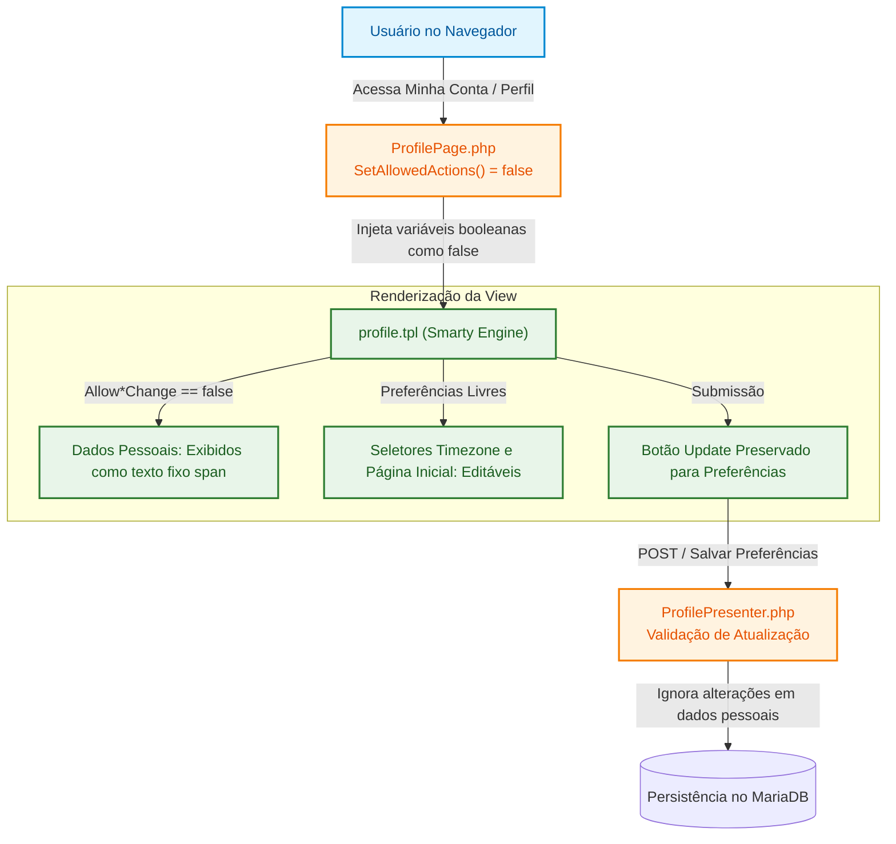

# ADR 0002: Perfil de Usuário em Modo Somente Leitura sob Autenticação Federada

| Metadado | Detalhe |
| :--- | :--- |
| **Status** |  |
| **Data da Decisão** | 2024-09-30 |
| **Decisores** | Equipe de Tecnologia da Informação / DTI UFCA |
| **Stakeholders** | Usuários da Comunidade Acadêmica, Gestores do Identity Provider (Keycloak) |
| **Tags** | `arquitetura`, `autenticacao`, `sso`, `keycloak`, `perfil`, `seguranca`, `ufca` |

---

## 1. Visão Executiva

Com a centralização da autenticação e gestão de identidades da **UFCA** no **Keycloak / LDAP institucional**, o LibreBooking deixa de ser a fonte autoritativa (*Single Source of Truth*) para dados cadastrais dos usuários.

Fica decidido que os dados de identidade (Nome, Sobrenome, E-mail, Telefone, Organização/Setor e Cargo) serão exibidos na tela de perfil (`MyAccount/profile.tpl`) em **modo estático (somente leitura)**. O formulário de edição desses campos cadastrais será desativado na camada de apresentação e protegido no backend, preservando exclusivamente a capacidade do usuário de configurar preferências individuais locais (Fuso Horário e Página Inicial Padrão).

---

## 2. Contexto e Declaração do Problema

No fluxo de autenticação via **Single Sign-On (SSO / SAML 2.0 / OIDC)**:
1. O usuário é autenticado externamente e seus atributos institucionais (Nome, E-mail, Matrícula/Vínculo) são provisionados automaticamente no LibreBooking via mapeamento de claims/atributos.
2. No comportamento padrão do LibreBooking (desenvolvido para ambientes locais autônomos), o usuário possui permissão para editar livremente seus dados cadastrais através da página `Web/profile.php`.
3. Se um usuário alterar seu nome ou e-mail diretamente no LibreBooking, ocorrerá:
   - **Divergência Cadastral:** Inconsistência entre os sistemas acadêmicos/administrativos da UFCA e o sistema de reservas.
   - **Quebra de Rastreabilidade e Auditoria:** Dificuldade em responsabilizar usuários pelo uso indevido de espaços ou equipamentos caso o e-mail ou nome exibido divirja do registro oficial.
   - **Potencial Conflito de Sincronização:** Em logins subsequentes via IdP, a sobrescrita dos atributos externos poderia causar falhas de sessão ou ambiguidades de identificação.

> [!IMPORTANT]
> A autoridade sobre as informações cadastrais dos membros da comunidade acadêmica pertence exclusivamente aos sistemas institucionais da UFCA (SIG/Keycloak/LDAP). Nenhuma aplicação satélite deve permitir alteração unilateral desses dados.

---

## 3. Drivers de Decisão

* **Autoridade Única de Identidade:** Garantir que o Keycloak e a base institucional permaneçam como a única fonte autoritativa de dados do usuário.
* **Integridade e Não-Repúdio:** Manter a consistência e auditabilidade das reservas institucionais.
* **Usabilidade e Autonomia de Preferências:** Não penalizar a experiência do usuário, permitindo que ele continue personalizando preferências de uso pessoal do sistema (ex.: página inicial preferida e fuso horário).
* **Segurança em Profundidade (*Defense in Depth*):** O bloqueio não deve depender apenas da interface gráfica (HTML/CSS), devendo ser validado no backend contra requisições forjadas (POST direto).

---

## 4. Opções Consideradas

| Critério | Opção A: Modo Leitura Parcial com Backend Protegido (Recomendada) | Opção B: Sincronização Bidirecional com IdP | Opção C: Ocultação Total da Tela de Perfil |
| :--- | :---: | :---: | :---: |
| **Esforço de Implementação** | **Baixo / Nativo** | Crítico (Demanda APIs no IdP) | Mínimo |
| **Integridade dos Dados** | **Totalmente Assegurada** | Risco de conflito / Sobrescrita | Assegurada |
| **Personalização de Preferências** | **Preservada (Timezone / DefaultPage)** | Preservada | Impossibilitada |
| **Aderência ao Padrão do Sistema** | **Total (Usa flags do Smarty / Presenter)** | Baixa (Requer engine de sync externa) | Baixa (Remove recurso padrão) |

---

## 5. Decisão Arquitetural

Adota-se a **Opção A**: configuração dos atributos cadastrais em modo estático/somente leitura através dos mecanismos nativos do LibreBooking, mantendo ativas as preferências do usuário.

### Detalhamento da Solução:

1. **Camada de Apresentação (PHP / Smarty):**
   - No arquivo `Pages/ProfilePage.php`, o método `SetAllowedActions()` é forçado a definir `false` para todas as ações de alteração cadastral:
     - `AllowEmailAddressChange => false`
     - `AllowNameChange => false`
     - `AllowOrganizationChange => false`
     - `AllowPhoneChange => false`
     - `AllowPositionChange => false`
     - `AllowUsernameChange => false`
   - O template Smarty `tpl/MyAccount/profile.tpl` já possui suporte nativo a essas diretivas: quando avaliadas como falsas, renderiza automaticamente tags `` informativas e inputs ocultos em vez de campos editáveis `<input type="text">`.

2. **Preservação do Botão de Atualização (`btnUpdate`):**
   - O botão `Update` permanece ativo no template para viabilizar o salvamento dos seletores de fuso horário e página de entrada, cujas alterações são legítimas.

3. **Blindagem no Backend (Presenter):**
   - O método `Update()` em `Presenters/ProfilePresenter.php` descarta qualquer tentativa de alteração manual de dados pessoais recebida via payload HTTP POST não autorizado.

---

## 6. Consequências e Trade-Offs

### Impactos Positivos

* **Confiabilidade Institucional:** Elimina a possibilidade de alterações não auditadas em nomes, matrículas ou e-mails no sistema de agendamento.
* **Aproveitamento de Recursos Nativos:** Utiliza a arquitetura já concebida pelo LibreBooking para autenticações externas (LDAP/SAML), minimizando débitos técnicos.
* **Autonomia de Experiência:** Usuários continuam aptos a customizar fuso horário e visualização inicial sem intervenção de suporte.

### Trade-Offs e Desafios

* **Procedimento de Atualização Cadastral:** Caso um usuário necessite corrigir seu nome civil ou e-mail, ele deverá realizar a atualização diretamente no sistema de RH/Acadêmico da UFCA, refletindo no LibreBooking no próximo ciclo de login.
* **Gestão de Cache de Templates (Smarty):** Modificações no template ou classes de página exigem a invalidação do diretório de compilação `/var/www/html/tpl_c/` nos containers em execução para surtirem efeito imediato.

---

## 7. Matriz de Riscos e Mitigações

| Risco | Severidade | Mitigação |
| :--- | :---: | :--- |
| **Bypass via requisição HTTP direta** | Alta | Sanitização e bloqueio das propriedades imutáveis diretamente no `ProfilePresenter.php`, impedindo persistência no `UserRepository`. |
| **Dúvidas de usuários sobre campos travados** | Baixa | Inclusão de mensagem explicativa na interface informando que os dados são geridos pelo sistema central da UFCA. |
| **Persistência de templates antigos em cache** | Média | Automatização da limpeza do diretório `tpl_c` no script de inicialização do container Docker. |

---

## 8. Plano de Ação

- [x] Levantamento da lógica interna de `Pages/ProfilePage.php` e `tpl/MyAccount/profile.tpl`.
- [ ] Implementação das diretivas em `ProfilePage.php` e trava no `ProfilePresenter.php`.
- [ ] Configuração do mapeamento correto de volumes Docker para desenvolvimento.
- [ ] Testes de submissão simulando requisições com campos alterados.
- [ ] Homologação do salvamento de Timezone e DefaultPage.

---

## 9. Referências e Links Úteis

* [ADR 0001: Adoção do LibreBooking para Gestão de Recursos na UFCA](./0001-adocao-librebooking-ufca.md)
* [ADR 0003: Bloqueio da Funcionalidade de Troca de Senha Local](./0003-bloqueio-troca-senha-local.md)
* [Guia Técnico: Modo Somente Leitura do Perfil](../guides/guia-perfil-modo-leitura.md)
