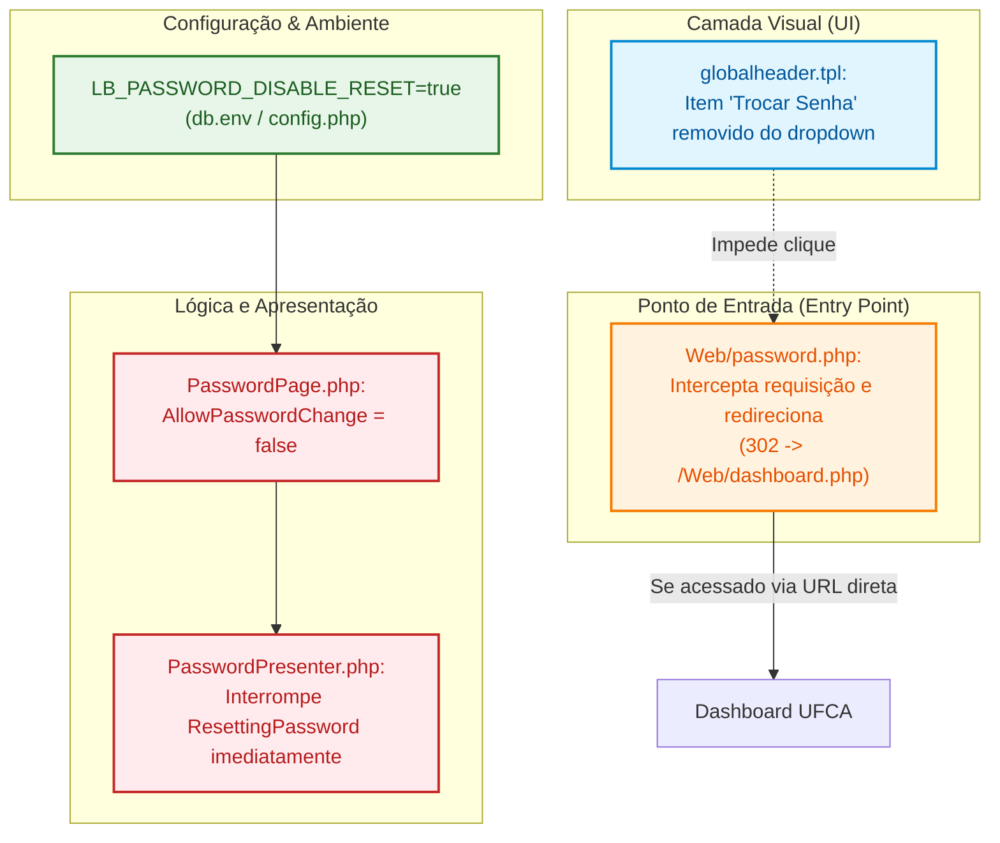

# ADR 0003: Bloqueio da Funcionalidade de Troca de Senha Local sob Autenticação Federada

| Metadado | Detalhe |
| :--- | :--- |
| **Status** |  |
| **Data da Decisão** | 2024-10-01 |
| **Decisores** | Equipe de Tecnologia da Informação / DTI UFCA |
| **Stakeholders** | Comunidade Acadêmica da UFCA, Equipe de Suporte e Infraestrutura de TI |
| **Tags** | `arquitetura`, `seguranca`, `autenticacao`, `sso`, `keycloak`, `senha`, `ufca` |

---

## 1. Visão Executiva

Como a autenticação institucional da **UFCA** é delegada ao **Keycloak (SSO / IdP)**, as credenciais dos usuários (senhas e fatores de autenticação) são gerenciadas de forma centralizada pela universidade.

Fica deliberado o **bloqueio total e desativação da funcionalidade de troca de senha local** no LibreBooking. A decisão adota uma abordagem de **defesa em profundidade (*Defense in Depth*)**, atuando simultaneamente nas 5 camadas da aplicação: remoção do link no menu de navegação, ativação da diretiva nativa `password.disable.reset`, bloqueio de rota direta com redirecionamento para o dashboard e interrupção de processamento no *Presenter*.

---

## 2. Contexto e Declaração do Problema

O LibreBooking foi concebido originariamente com suporte a contas de usuários locais, fornecendo telas para redefinição de senha (`Web/password.php`), formulário de alteração de senha autenticada (`tpl/MyAccount/password.tpl`) e link no menu superior da aplicação (`tpl/globalheader.tpl`).

No entanto, no ecossistema da UFCA:
1. **Centralização de Credenciais:** As senhas dos membros da universidade são custodiadas pelo servidor de identidades institucional (LDAP/Keycloak).
2. **Risco de Falsa Sensação de Segurança e Frustração:** Permitir que o usuário altere sua senha dentro do LibreBooking poderia levar à suposição de que sua senha institucional foi alterada, ou gerar falhas na sincronização de credenciais.
3. **Segurança de Acesso:** Manter rotas ativas de troca de senha no aplicativo amplia a superfície de ataque desnecessariamente para ambientes federados.

> [!IMPORTANT]
> Em nenhum momento o LibreBooking deve permitir a redefinição ou alteração de senhas quando operando integrado ao SSO institucional da UFCA. Qualquer ciclo de vida de senha deve ser conduzido estritamente no portal de identidade da universidade.

---

## 3. Drivers de Decisão

* **Consistência de Credenciais:** Evitar dessincronização entre credenciais locais e o Keycloak.
* **Experiência do Usuário (UX):** Reduzir confusão visual e prevenir a abertura indevida de chamados de suporte junto à DTI.
* **Defesa em Profundidade (*Defense in Depth*):** Garantir que a desativação não seja apenas visual, mas bloqueada em todas as camadas (HTTP, Controller, Model).
* **Manutenibilidade:** Aproveitar as configurações nativas de segurança oferecidas pelo próprio LibreBooking sempre que possível.

---

## 4. Opções Consideradas

| Critério | Opção A: Apenas Mensagem Informativa na Tela | Opção B: Apenas Ocultação do Link no Menu | Opção C: Defesa em Profundidade em 5 Camadas (Recomendada) |
| :--- | :---: | :---: | :---: |
| **Proteção contra Acesso Direto por URL** | Fraca (Usuário ainda acessa a rota) | Nula (Acesso direto por `/Web/password.php`) | **Total (Redirecionamento HTTP automático)** |
| **Limpeza Visual da Interface** | Média (Mantém item no menu) | Boa (Menu limpo) | **Excelente (Menu limpo e sem rotas mortas)** |
| **Proteção contra POST Forjado** | Dependente do Presenter | Inexistente | **Completa (Presenter descarta o processamento)** |
| **Configurabilidade por Ambiente** | Baixa (Hardcoded) | Baixa | **Alta (Uso de `LB_PASSWORD_DISABLE_RESET`)** |

---

## 5. Decisão Arquitetural

Adota-se a **Opção C**: implementação em múltiplas camadas coordenadas.



### Detalhamento das 5 Camadas de Bloqueio:

1. **Camada 1 — Variável de Configuração Global:**
   - Habilitação da chave `password.disable.reset = true` (via variável de ambiente `LB_PASSWORD_DISABLE_RESET=true` no arquivo de configuração do container).
   - O LibreBooking desabilita nativamente os formulários de redefinição e seta a permissão `$AllowPasswordChange = false`.

2. **Camada 2 — Menu de Navegação (`tpl/globalheader.tpl`):**
   - Comentada a linha do dropdown de conta correspondente ao link `#navPassword`:
     ```html
     <!-- <li id="navPassword"><a class="dropdown-item" href="{$Path}{Pages::PASSWORD}">{translate key="ChangePassword"}</a></li> -->
     ```
   - Evita ruído visual e links irrelevantes para o usuário final.

3. **Camada 3 — Interceptação de Rota Web (`Web/password.php`):**
   - Inserção de redirecionamento preventivo logo no cabeçalho do arquivo:
     ```php
     header('Location: ' . ROOT_DIR . 'Web/dashboard.php');
     exit;
     ```
   - Impede que usuários que conheçam a rota legada visualizem formulários órfãos.

4. **Camada 4 — Controlador da View (`Pages/PasswordPage.php`):**
   - Forçada a atribuição `$this->Set('AllowPasswordChange', false)` no método `SetAllowedActions()`.

5. **Camada 5 — Regra de Negócio no Backend (`Presenters/PasswordPresenter.php`):**
   - Adicionada cláusula de guarda no método `PageLoad()`:
     ```php
     if ($this->page->ResettingPassword()) {
         return; // Interrompe processamento sem tocar no banco de dados
     }
     ```

---

## 6. Consequências e Trade-Offs

### Impactos Positivos

* **Alinhamento Institucional:** Redireciona a atenção do usuário para os canais corretos de autoatendimento da universidade.
* **Segurança Reforçada:** Bloqueio robusto tanto contra usuários leigos quanto contra requisições maliciosas forjadas via DevTools ou scripts automatizados.
* **Código Sustentável:** Uso simultâneo de flags oficiais do LibreBooking e travas mínimas e cirúrgicas no código-fonte.

### Trade-Offs e Desafios

* **Fluxo de Esquecimento de Senha:** Caso um usuário esqueça sua senha, o LibreBooking não provê o serviço de recuperação; ele deve ser orientado a utilizar o fluxo de recuperação de conta próprio do Keycloak/SIG da UFCA.

---

## 7. Matriz de Riscos e Mitigações

| Risco | Severidade | Mitigação |
| :--- | :---: | :--- |
| **Tentativas de injeção direta de payload POST** | Alta | Proteção nativa no `PasswordPresenter.php`, que aborta a atualização do hash de senha no banco. |
| **Tentativa de acesso por bookmarks salvos no navegador** | Média | O arquivo `Web/password.php` redireciona o tráfego HTTP 302 diretamente para `Web/dashboard.php`. |
| **Sobrescrita após atualização de versão (*upstream*)** | Média | A maior parte da proteção advém da flag `LB_PASSWORD_DISABLE_RESET=true`, que independe de alterações no core. |

---

## 8. Plano de Ação

- [x] Levantamento da arquitetura de troca de senha no LibreBooking.
- [ ] Ativação da variável `LB_PASSWORD_DISABLE_RESET=true` no ambiente Docker (`lb.env` / `docker-compose.yml`).
- [ ] Remoção visual do item no menu `tpl/globalheader.tpl`.
- [ ] Inclusão do redirecionamento em `Web/password.php` e trava no `PasswordPresenter.php`.
- [ ] Limpeza do cache do Smarty e teste de regressão em ambiente de homologação.

---

## 9. Referências e Links Úteis

* [ADR 0001: Adoção do LibreBooking para Gestão de Recursos na UFCA](./0001-adocao-librebooking-ufca.md)
* [ADR 0002: Perfil de Usuário em Modo Somente Leitura sob Autenticação Federada](./0002-perfil-usuario-modo-somente-leitura.md)
* [Guia Técnico: Bloqueio da Troca de Senha](../guides/guia-bloqueio-troca-senha.md)
