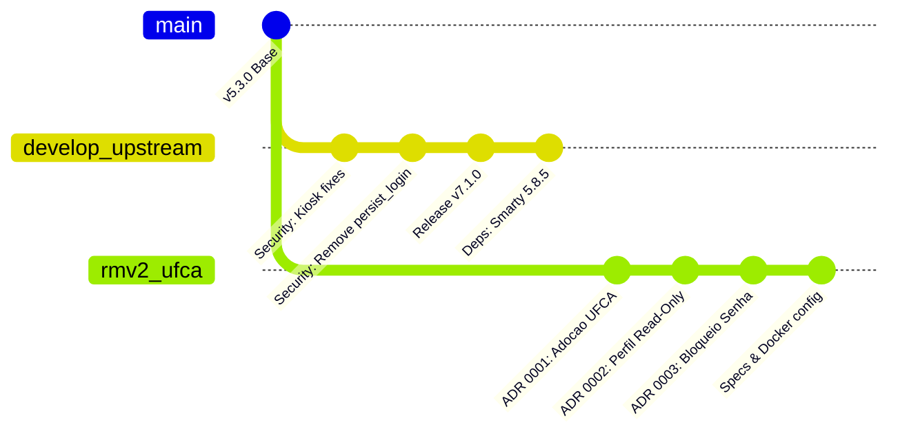
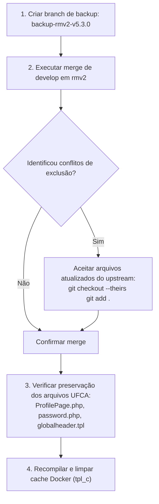

# ADR 0004: Atualização para LibreBooking v7.1.0 e Mitigação de Vulnerabilidades Críticas

| Metadado | Detalhe |
| :--- | :--- |
| **Status** |  |
| **Data da Decisão** | 2026-10-19 |
| **Decisores** | Equipe de Tecnologia da Informação / DTI UFCA |
| **Stakeholders** | Administradores do Sistema, Usuários Finais da UFCA, Gestores de Infraestrutura e Redes |
| **Tags** | `seguranca`, `cve`, `autenticacao`, `librebooking`, `upgrade`, `v7.1.0`, `cookies`, `kiosk` |

---

## 1. Visão Executiva

O projeto upstream oficial do LibreBooking lançou a versão **v7.1.0** para solucionar uma vulnerabilidade de segurança crítica de **Account Takeover sem autenticação** decorrente do mecanismo legado de *Lembrar-me* (`persist_login`), além de correções em reservas públicas de quiosques/tablets.

Este registro documenta a análise de impacto, a comparação técnica entre a ramificação customizada da UFCA (`rmv2`, baseada na v5.3.0) e a versão **v7.1.0** (`develop`), a validação de integridade das customizações institucionais existentes (ADRs 0001, 0002 e 0003) e o procedimento operacional seguro para incorporação dessas correções no ambiente em execução.

---

## 2. Contexto e Declaração do Problema

### 2.1. A Vulnerabilidade de Autenticação (GHSA-mvjx-72w3-wqhp)
No ciclo v7.0.x e em versões herdadas do LibreBooking (incluindo a v5.3.0), o fluxo de autenticação persistente utilizava o cookie HTTP `persist_login`:
1. **Ausência de Requisito de Conta:** Um atacante não precisava ter conta prévia no sistema.
2. **Forjamento de Cookie:** A implementação permitia forjar o valor do cookie baseado em atributos previsíveis ou estáticos (contas que nunca logaram podiam ser exploradas sem conhecimento de timestamps; para contas já acessadas, estimava-se o último login).
3. **Escalação para Administrador:** A exploração resultava na obtenção de sessão legítima com os privilégios do usuário-alvo, viabilizando o controle irrestrito da instância e dos agendamentos de salas da universidade.

### 2.2. Falhas em Dispositivos de Autoatendimento (Kiosks / Tablets)
Além do cookie de login, a equipe do LibreBooking identificou e corrigiu duas vulnerabilidades operacionais em reservas feitas via tablet/quiosque:
- **Herança indevida de privilégios (`fa454d019`):** Reservas de quiosque realizadas após sessões de administrador retinham isenções de permissão.
- **Reserva de recursos arbitrários (`265aca30d`):** A requisição de quiosque confiava no ID interno enviado pelo cliente HTTP, permitindo reservar salas e equipamentos que não estavam autorizados para exibição e uso público no tablet.

---

## 3. Drivers de Decisão

* **Eliminação de Risco de Sequestro de Sessão:** Proteger contas administrativas e docentes contra impersonação não autorizada.
* **Preservação das Customizações UFCA:** Garantir que o Perfil Somente Leitura ([ADR 0002](./0002-perfil-usuario-modo-somente-leitura.md)) e o Bloqueio de Troca de Senha ([ADR 0003](./0003-bloqueio-troca-senha-local.md)) permaneçam intactos.
* **Continuidade do Ambiente de Produção/Docker:** Evitar quebras de dependências ou parada de serviços de reservas durante a atualização.

---

## 4. Comparação Técnica: `rmv2` (UFCA) vs `develop` (Upstream v7.1.0)



| Componente / Área | Ramificação Local `rmv2` (UFCA) | Upstream `develop` (v7.1.0) | Status de Compatibilidade / Impacto |
| :--- | :--- | :--- | :--- |
| **Versão Base** | `5.3.0` | `7.1.0` | Atualização de versão do core |
| **"Lembrar-me" (`persist_login`)** | Presente em `tpl/login.tpl` e `LoginPresenter.php` | **Totalmente removido** | **Crítico:** Deve ser incorporado para sanar a falha |
| **Perfil de Usuário** | Customizado em `Pages/ProfilePage.php` (Read-only) | Sem alterações conflitantes | **Compatível:** Mantém regras da UFCA |
| **Troca de Senha** | Bloqueado em `Web/password.php` e `tpl/globalheader.tpl` | Sem alterações conflitantes | **Compatível:** Mantém regras da UFCA |
| **Reservas de Quiosque** | Comportamento padrão herdado da 5.3.0 | Sessões restritas e validação via ID público | **Melhoria:** Aumenta a segurança física/local |
| **Motor de Templates** | Smarty 5.8.x | Smarty 5.8.5 + limpeza de legados (`migrate.tpl`) | **Compatível:** Requer purga do diretório `tpl_c` |
| **Documentação & ADRs** | Diretório `docs/architecture-decision-records/` e `specs/` | Não interfere nos diretórios da UFCA | **Sem conflito:** Arquivos exclusivos da UFCA |

---

## 5. Detalhamento das Alterações de Segurança do Upstream

1. **Remoção Completa do "Remember Me" (Commit `ddfd63f7f`):**
   - Exclusão do checkbox e tradução correspondente em `tpl/login.tpl`.
   - Remoção dos métodos `CookieLogin()`, `DeletePersistLoginCookie()` e `ShowPersistLoginPrompt()` em `Presenters/LoginPresenter.php` e `WebAuthentication.php`.
   - Exclusão de classes legadas de consulta SQL vinculadas ao token (`CookieLoginCommand`).
   - *Resultado:* Tokens antigos gravados em navegadores são rejeitados; novos cookies não são criados.

2. **Isolamento de Sessão em Quiosques / Tablets (Commit `fa454d019`):**
   - Criação de uma cópia restrita da sessão ao reservar via display público (`Domain/Access/ScheduleUserRepository.php` e `lib/Server/UserSession.php`).
   - Bloqueio da recuperação de papéis administrativos salvos em agendamentos subsequentes no mesmo dispositivo compartilhado.

3. **Validação Estrita de Recursos em Display (Commit `265aca30d`):**
   - Verificação obrigatória do ID público do tablet em `Presenters/ResourceDisplayPresenter.php` antes de instanciar qualquer reserva de convidado.
   - Rejeição imediata caso o recurso solicitado não esteja formalmente habilitado para exibição pública.

4. **Políticas de Validação de Senha (Commits `d1d27d1db` e `c811eb1ca`):**
   - Criação de `lib/Common/Validators/PasswordComplexityValidator.php` para reforço de regras de tamanho mínimo e complexidade de caracteres.

---

## 6. Decisão Arquitetural e Estratégia de Atualização

Adota-se a incorporação das correções da **v7.1.0** na branch de execução `rmv2` por meio de **Merge Estruturado com Ponto de Restauração**, seguindo as seguintes etapas:



### Justificativa da Escolha:
- Os arquivos modificados pela UFCA para aplicar as políticas acadêmicas (`Pages/ProfilePage.php`, `Web/password.php`, `tpl/globalheader.tpl`) **não foram alterados no upstream 7.1.0**.
- Os eventuais avisos de conflito no merge referem-se estritamente a arquivos que haviam sido limpos/deletados no primeiro commit do repositório local (como traduções secundárias em `lang/` e workflows de CI), sendo resolvidos mantendo o código atualizado do upstream.

---

## 7. Consequências e Trade-Offs

### Impactos Positivos:
* **Mitigação Definitiva de Account Takeover:** Invalidação dos cookies de autenticação persistente e bloqueio contra novos ataques.
* **Segurança Reforçada em Quiosques:** Prevenção contra elevação de privilégios em totens de autoatendimento na UFCA.
* **Manutenção da Conformidade com ADRs Anteriores:** Os usuários continuam sem poder alterar dados pessoais no perfil ou trocar senhas localmente, respeitando a federação com Keycloak/LDAP.

### Trade-Offs e Cuidados:
* **Necessidade de Re-login:** Usuários com sessões antigas ou cookies persistentes nos navegadores precisarão digitar suas credenciais novamente no próximo acesso.
* **Invalidação de Cache:** A pasta de templates compilados (`/var/www/html/tpl_c`) do container PHP precisa ser purgada para garantir a remoção imediata do campo na tela de login.

---

## 8. Procedimento Operacional de Atualização

```bash
# 1. Garantir que estamos no diretório do projeto
cd /home/csi/Documentos/librebooking

# 2. Criar uma ramificação de backup de segurança
git branch backup-rmv2-v5.3.0

# 3. Mudar para a branch em operação
git checkout rmv2

# 4. Mesclar as correções da versão 7.1.0 presentes em develop
git merge develop -m "merge: atualizacao para v7.1.0 e correcoes criticas de seguranca"

# Nota: Caso o Git reporte conflitos de exclusão em arquivos de idiomas/workflows:
# git checkout --theirs lang/ .github/
# git add -A && git commit -m "fix(merge): resolução de arquivos auxiliares"

# 5. Conferir se as customizações UFCA continuam ativas
git status

# 6. Reiniciar o ambiente Docker limpando o cache Smarty
cd librebooking-docker
docker compose restart
# Se necessário purgar templates compilados:
docker compose exec web rm -rf /var/www/html/tpl_c/*
```

---

## 9. Referências e Links Úteis

* [GitHub Security Advisory GHSA-mvjx-72w3-wqhp](https://github.com/LibreBooking/librebooking/security/advisories/GHSA-mvjx-72w3-wqhp)
* [Commit ddfd63f7f: Remoção do Remember-Me](https://github.com/LibreBooking/librebooking/commit/ddfd63f7f)
* [Commit fa454d019: Correção de Sessão em Quiosques](https://github.com/LibreBooking/librebooking/commit/fa454d019)
* [ADR 0001: Adoção do LibreBooking na UFCA](./0001-adocao-librebooking-ufca.md)
* [ADR 0002: Perfil de Usuário em Modo Somente Leitura](./0002-perfil-usuario-modo-somente-leitura.md)
* [ADR 0003: Bloqueio da Funcionalidade de Troca de Senha Local](./0003-bloqueio-troca-senha-local.md)
