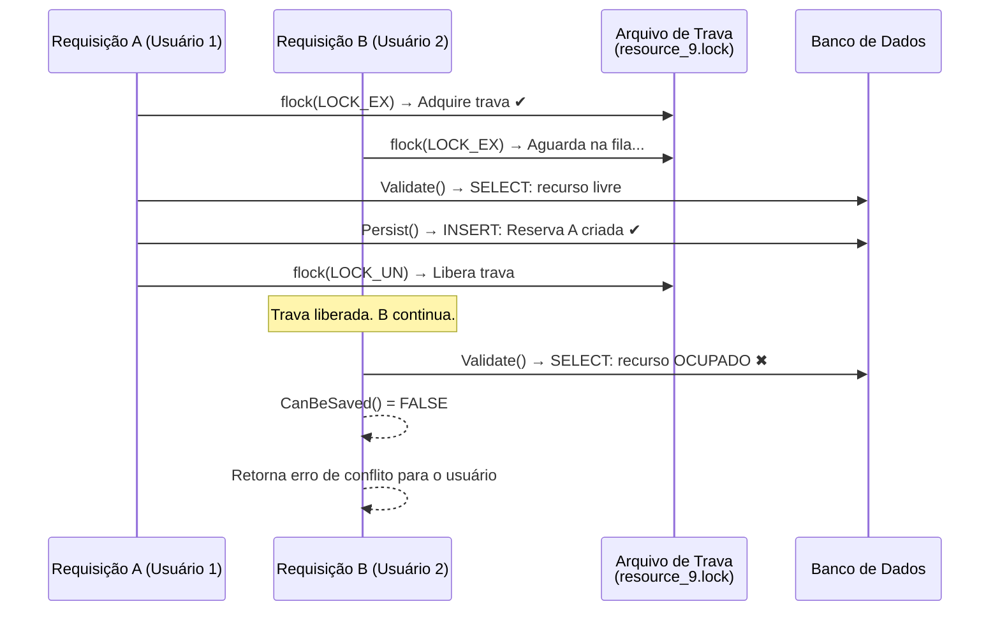

# ADR 0005: Correção de Race Condition (Reserva Dupla) no ReservationHandler

| Metadado | Detalhe |
| :--- | :--- |
| **Status** |  |
| **Data da Decisão** | 2026-10-21 |
| **Decisores** | Equipe de Tecnologia da Informação / DTI UFCA |
| **Stakeholders** | Administradores do Sistema, Usuários Finais da UFCA, Gestores de Infraestrutura |
| **Tags** | `segurança`, `concorrência`, `race-condition`, `double-booking`, `mutex`, `flock`, `reservas`, `ReservationHandler` |

---

## 1. Visão Executiva

Durante testes de estresse realizados pela equipe de desenvolvimento, foi identificada e confirmada uma vulnerabilidade de **Race Condition (Condição de Corrida)** no fluxo de criação de reservas do LibreBooking. A falha permite que **dois usuários diferentes reservem o mesmo recurso no mesmo horário simultaneamente**, resultando em **Double Booking** (Reserva Dupla).

Este registro documenta a análise técnica da falha, sua causa raiz no código-fonte, a decisão arquitetural adotada para corrigi-la e o procedimento de aplicação da correção no ambiente em execução.

---

## 2. Contexto e Declaração do Problema

### 2.1. A Vulnerabilidade: Double Booking por TOCTOU

A falha identificada é classificada como **TOCTOU (*Time-of-Check to Time-of-Use*)**: o sistema verifica a disponibilidade do recurso em um momento (*check*), mas um segundo processo pode inserir dados no banco entre essa verificação e a gravação efetiva (*use*), invalidando a checagem original.

**Reprodução da Falha (sequência de eventos):**

```
Requisição A (Usuário 1)               Requisição B (Usuário 2)
──────────────────────────             ──────────────────────────
1. Inicia Validate()                   1. Inicia Validate()
2. SELECT banco: Boardroom A livre     2. SELECT banco: Boardroom A livre
3. CanBeSaved() → TRUE                 3. CanBeSaved() → TRUE
4. INSERT reservation_series           
5. INSERT reservation_instances        4. INSERT reservation_series
6. Reserva A criada com sucesso ✔     5. INSERT reservation_instances
                                       6. Reserva B criada com sucesso ✔ ← CONFLITO!
```

Ambas as requisições retornam sucesso. O banco de dados passa a ter **duas reservas válidas para o mesmo recurso e horário**.

### 2.2. Causa Raiz no Código

O fluxo de criação de reservas é centralizado no arquivo:

> `lib/Application/Reservation/ReservationHandler.php` → método `Handle()`

O código original executava:

```php
// 1. Verifica se pode salvar (consulta o banco de dados)
$validationResult = $this->validationService->Validate($reservationSeries, ...);

// 2. Se válido, persiste no banco
if ($validationResult->CanBeSaved()) {
    $this->persistenceService->Persist($reservationSeries); // ← Janela de vulnerabilidade aqui
}
```

**Entre as linhas 1 e 2 não existe qualquer mecanismo de exclusão mútua.** As requisições concorrentes são atendidas por processos Apache separados e independentes no PHP-FPM, e o sistema **não utiliza transações de banco com bloqueio (`SELECT ... FOR UPDATE`)** nem qualquer trava no nível de aplicação.

Adicionalmente, as tabelas `reservation_instances` e `reservation_resources` armazenam datas de início/fim em colunas separadas do recurso. O MariaDB/MySQL não possui `UNIQUE CONSTRAINTS` nativos capazes de detectar sobreposição de intervalos de tempo, tornando o banco **100% dependente da validação em PHP** — que, sem proteção de concorrência, é insuficiente.

---

## 3. Drivers de Decisão

* **Integridade das Reservas:** Garantir que nunca existam duas reservas válidas para o mesmo recurso e horário.
* **Compatibilidade com a Arquitetura Existente:** A solução deve operar dentro do PHP/Apache sem exigir alterações no schema do banco de dados ou na configuração do MariaDB.
* **Impacto Mínimo no Restante do Sistema:** A correção deve ser localizada, preservando todas as customizações UFCA existentes ([ADR 0002](./0002-perfil-usuario-modo-somente-leitura.md), [ADR 0003](./0003-bloqueio-troca-senha-local.md)).
* **Manutenibilidade:** O mecanismo deve ser simples, legível e compatível com atualizações futuras do upstream.

---

## 4. Opções Consideradas

### Opção A: Trava por arquivo no sistema operacional (`flock`) — **ESCOLHIDA**
Utilizar `flock()` nativo do PHP para criar um arquivo de trava por recurso no sistema de arquivos do servidor. O processo Apache que chegar primeiro adquire a trava exclusiva; o segundo aguarda na fila. Quando o primeiro termina de validar e gravar, o segundo executa sua própria validação — que desta vez detecta o conflito e rejeita a reserva corretamente.

- ✅ Nativo do PHP: sem novas dependências.
- ✅ Garante exclusão mútua atômica entre processos Apache.
- ✅ Funciona identicamente para criações e atualizações de reservas.
- ✅ Libera a trava automaticamente via bloco `finally` mesmo em caso de exceção.
- ⚠️ Requer que o diretório de travas (`/tmp/librebooking_locks/`) seja acessível pelo usuário `www-data`.

### Opção B: Lock de banco de dados (`GET_LOCK()` no MariaDB)
Executar `SELECT GET_LOCK('lock_resource_X', timeout)` via SQL antes de cada validação.

- ✅ Funciona no nível do banco.
- ❌ Mais complexo: exige nova abstração no `MySqlConnection.php` para executar SQL puro fora dos `SqlCommand`.
- ❌ Bloqueia a conexão de banco (que é aberta/fechada por query no `Database.php`), dificultando a gestão do timeout.

### Opção C: Trigger `BEFORE INSERT` no MariaDB
Criar uma trigger que verifique sobreposições antes de inserir na tabela `reservation_instances` e lance um `SIGNAL SQLSTATE '45000'` em caso de conflito.

- ✅ Completamente atômica no banco.
- ❌ Exige migração de schema no banco de dados de produção.
- ❌ A mensagem de erro chegaria ao usuário como uma exceção não tratada pelo LibreBooking.
- ❌ Dificultaria atualizações futuras do schema do upstream.

---

## 5. Decisão Arquitetural

**Adota-se a Opção A: trava por arquivo (`flock`) no método `Handle()` do `ReservationHandler.php`.**

O mecanismo envolve:
1. **Coleta e ordenação dos IDs dos recursos** da reserva em ordem crescente antes de adquirir as travas, prevenindo deadlocks em reservas que envolvem múltiplos recursos.
2. **Aquisição de trava exclusiva bloqueante** (`LOCK_EX`) para cada arquivo de trava correspondente a um recurso.
3. **Execução da validação e persistência** dentro da seção protegida.
4. **Liberação incondicional das travas** no bloco `finally`, garantindo que nenhum processo fique preso mesmo em caso de exceção PHP.



---

## 6. Alteração de Código

**Arquivo alterado:** `lib/Application/Reservation/ReservationHandler.php`

**Método alterado:** `Handle(ReservationSeries $reservationSeries, IReservationSaveResultsView $view)`

### Código Antes da Correção:

```php
public function Handle($reservationSeries, IReservationSaveResultsView $view)
{
    $this->retryOptions->AdjustReservation($reservationSeries, $view->GetRetryParameters());
    $validationResult = $this->validationService->Validate($reservationSeries, $view->GetRetryParameters());
    $result = $validationResult->CanBeSaved();

    if ($validationResult->CanBeSaved()) {
        try {
            $this->persistenceService->Persist($reservationSeries);
        } catch (Exception $ex) {
            Log::Error('Error saving reservation: %s', $ex);
            throw($ex);
        }

        $this->notificationService->Notify($reservationSeries);
        $view->SetSaveSuccessfulMessage($result);
    } else {
        $view->SetSaveSuccessfulMessage($result);
        $view->SetErrors($validationResult->GetErrors());
        $view->SetCanBeRetried($validationResult->CanBeRetried());
        $view->SetRetryParameters($validationResult->GetRetryParameters());
        $view->SetRetryMessages($validationResult->GetRetryMessages());
        $view->SetCanJoinWaitList($validationResult->CanJoinWaitList() && Configuration::Instance()->GetKey(
            ConfigKeys::RESERVATION_ALLOW_WAITLIST,
            new BooleanConverter()
        ));
    }

    $view->SetWarnings($validationResult->GetWarnings());
    return $result;
}
```

### Código Após a Correção (com Mutex por `flock`):

```php
public function Handle($reservationSeries, IReservationSaveResultsView $view)
{
    $lockHandles = [];

    try {
        // 1. Coleta e ordena os IDs dos recursos para evitar deadlocks em
        //    reservas com múltiplos recursos (garante que todos os processos
        //    tentem adquirir as travas na mesma sequência).
        if (method_exists($reservationSeries, 'AllResources')) {
            $resourceIds = [];
            foreach ($reservationSeries->AllResources() as $resource) {
                $resourceIds[] = $resource->GetId();
            }
            sort($resourceIds);

            $lockDir = sys_get_temp_dir() . '/librebooking_locks';
            if (!is_dir($lockDir)) {
                @mkdir($lockDir, 0777, true);
            }

            // 2. Adquire trava exclusiva bloqueante por recurso.
            //    O segundo processo fica em espera aqui até o primeiro liberar.
            foreach ($resourceIds as $resId) {
                $fp = fopen($lockDir . '/resource_' . $resId . '.lock', 'c');
                if ($fp) {
                    flock($fp, LOCK_EX);
                    $lockHandles[] = $fp;
                }
            }
        }

        // 3. Seção crítica: validação e persistência protegidas pela trava.
        $this->retryOptions->AdjustReservation($reservationSeries, $view->GetRetryParameters());
        $validationResult = $this->validationService->Validate($reservationSeries, $view->GetRetryParameters());
        $result = $validationResult->CanBeSaved();

        if ($validationResult->CanBeSaved()) {
            try {
                $this->persistenceService->Persist($reservationSeries);
            } catch (Exception $ex) {
                Log::Error('Error saving reservation: %s', $ex);
                throw($ex);
            }

            $this->notificationService->Notify($reservationSeries);
            $view->SetSaveSuccessfulMessage($result);
        } else {
            $view->SetSaveSuccessfulMessage($result);
            $view->SetErrors($validationResult->GetErrors());
            $view->SetCanBeRetried($validationResult->CanBeRetried());
            $view->SetRetryParameters($validationResult->GetRetryParameters());
            $view->SetRetryMessages($validationResult->GetRetryMessages());
            $view->SetCanJoinWaitList($validationResult->CanJoinWaitList() && Configuration::Instance()->GetKey(
                ConfigKeys::RESERVATION_ALLOW_WAITLIST,
                new BooleanConverter()
            ));
        }

        $view->SetWarnings($validationResult->GetWarnings());
        return $result;

    } finally {
        // 4. Liberação incondicional das travas (executado mesmo em exceções).
        while (!empty($lockHandles)) {
            $fp = array_pop($lockHandles);
            flock($fp, LOCK_UN);
            fclose($fp);
        }
    }
}
```

---

## 7. Consequências e Trade-Offs

### Impactos Positivos

* **Eliminação Definitiva do Double Booking:** A janela de vulnerabilidade entre a validação e a gravação é fechada. Requisições simultâneas são serializada por recurso.
* **Correção Localizada e Não Invasiva:** Somente o método `Handle()` do `ReservationHandler.php` foi modificado. Nenhuma alteração no banco de dados, em templates, em arquivos de configuração ou nos demais presenters.
* **Compatibilidade com ADRs Anteriores:** As customizações UFCA de [ADR 0002](./0002-perfil-usuario-modo-somente-leitura.md) e [ADR 0003](./0003-bloqueio-troca-senha-local.md) não são afetadas.
* **Cobertura Abrangente:** O `ReservationHandler` é o ponto central chamado tanto pela criação (`ReservationSavePresenter`), quanto pela atualização (`ReservationUpdatePresenter`), aprovação (`ReservationApprovalPresenter`) e check-in (`ReservationCheckinPresenter`). A correção cobre todos os fluxos.

### Trade-Offs e Cuidados

* **Serialização por Recurso:** Requisições para o **mesmo recurso** no **mesmo horário** são enfileiradas. Requisições para recursos ou horários diferentes **não são impactadas** — paralelismo normal é mantido.
* **Diretório de Travas:** O diretório `/tmp/librebooking_locks/` é criado automaticamente se não existir. Em ambientes Docker com múltiplas réplicas do container `app`, cada réplica teria seu próprio `/tmp`, tornando a trava ineficaz entre instâncias. **Para ambientes com múltiplas réplicas, recomenda-se montar um volume compartilhado** (ex: `/locks`) e alterar o `$lockDir` no código para esse caminho.
* **Limpeza de Arquivos de Trava:** Os arquivos `.lock` são criados mas não deletados, pois deletar antes de liberar a trava introduziria uma nova race condition. Eles são pequenos (0 bytes) e podem ser removidos periodicamente via cron sem impacto.

---

## 8. Procedimento de Aplicação da Correção

### 8.1 Aplicar a Alteração no Código-Fonte

Editar o arquivo no repositório do projeto:

```bash
cd /home/csi/Documentos/librebooking
# Editar lib/Application/Reservation/ReservationHandler.php
# conforme o diff descrito na seção 6 deste documento
```

### 8.2 Verificar que o Container Usa o Código Atualizado

O `docker-compose.yml` mapeia o código do host para o container via volume bind.
Confirmar que o arquivo está sincronizado:

```bash
docker exec librebooking-app-1 md5sum /var/www/html/lib/Application/Reservation/ReservationHandler.php
md5sum /home/csi/Documentos/librebooking/lib/Application/Reservation/ReservationHandler.php
# Os hashes devem ser idênticos
```

### 8.3 Verificar Permissão do Diretório de Travas no Container

```bash
docker exec librebooking-app-1 mkdir -p /tmp/librebooking_locks
docker exec librebooking-app-1 chmod 777 /tmp/librebooking_locks
docker exec librebooking-app-1 ls -ld /tmp/librebooking_locks
```

### 8.4 Reiniciar o Serviço de Aplicação

```bash
cd /home/csi/Documentos/librebooking/librebooking-docker
docker compose restart app cron
```

### 8.5 Verificar os Logs Após a Reinicialização

```bash
docker compose logs -f app --tail=50
```

---

## 9. Referências Técnicas

* **Arquivo Alterado:** [`lib/Application/Reservation/ReservationHandler.php`](../../lib/Application/Reservation/ReservationHandler.php)
* **Arquivo de Validação de Conflitos:** [`lib/Application/Reservation/ReservationConflictIdentifier.php`](../../lib/Application/Reservation/ReservationConflictIdentifier.php)
* **Regra de Disponibilidade de Recurso:** [`lib/Application/Reservation/Validation/ResourceAvailabilityRule.php`](../../lib/Application/Reservation/Validation/ResourceAvailabilityRule.php)
* **Schema da Tabela de Reservas:** [`database_schema/create-schema.sql`](../../database_schema/create-schema.sql) (tabelas `reservation_series`, `reservation_instances`, `reservation_resources`)
* **PHP `flock()` Documentation:** https://www.php.net/manual/en/function.flock.php
* **TOCTOU Wikipedia:** https://en.wikipedia.org/wiki/Time-of-check_to_time-of-use
* [ADR 0001: Adoção do LibreBooking na UFCA](./0001-adocao-librebooking-ufca.md)
* [ADR 0002: Perfil de Usuário em Modo Somente Leitura](./0002-perfil-usuario-modo-somente-leitura.md)
* [ADR 0003: Bloqueio da Funcionalidade de Troca de Senha Local](./0003-bloqueio-troca-senha-local.md)
* [ADR 0004: Atualização para LibreBooking v7.1.0](./0004-atualizacao-v7-1-0-seguranca-upstream.md)
