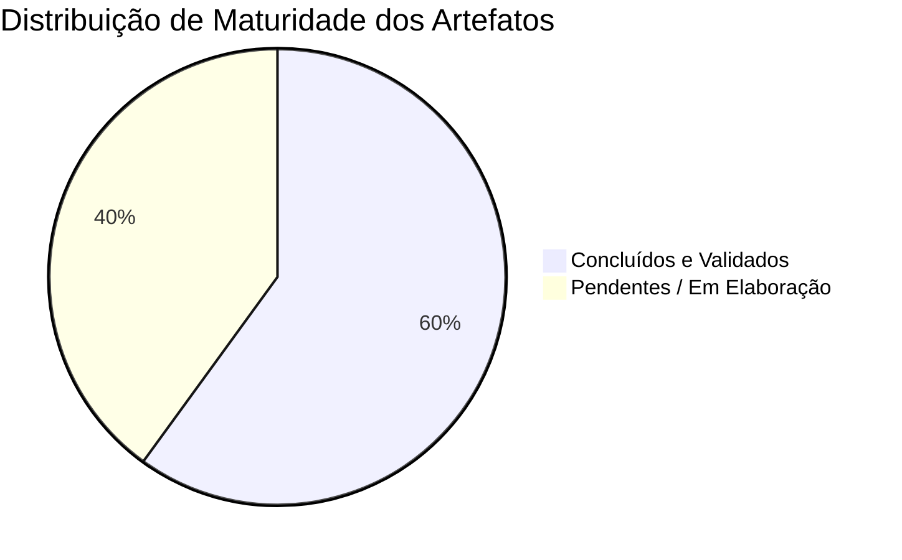

# Roadmap e Pendências — LibreBooking UFCA

| Metadado | Detalhe |
| :--- | :--- |
| **Status do Projeto** |  |
| **Última Atualização** | 2024-10-01 |
| **Responsável** | Equipe DTI / UFCA |
| **Repositório Base** | `file:///home/csi/Documentos/librebooking/` |

---

## 1. Visão Geral do Projeto

Este documento centraliza o **status de maturidade**, os **artefatos de engenharia concluídos** e a **matriz de pendências técnicas** prioritárias para a implantação e homologação do LibreBooking como plataforma institucional de agendamento de recursos na Universidade Federal do Cariri (UFCA).

---

## 2. Status Geral da Documentação e Arquitetura

### Artefatos Concluídos e Validados

| Artefato | Localização | Descrição / Finalidade |
| :--- | :--- | :--- |
| **Arquitetura Geral** | [`docs/architecture.md`](./architecture.md) | Documento para aprovação de go-live (containers, stack PHP 8.2, MariaDB 10.6, SSO Keycloak). |
| **Dicionário de Configuração** | [`docs/configuration.md`](./configuration.md) | Mapeamento completo dos parâmetros e chaves do arquivo `config/config.php`. |
| **ADR 0001 (Adoção)** | [`docs/architecture-decision-records/0001-adocao-librebooking-ufca.md`](./architecture-decision-records/0001-adocao-librebooking-ufca.md) | Justificativa técnica e institucional de migração do Booked para o LibreBooking. |
| **ADR 0002 (Perfil Read-Only)** | [`docs/architecture-decision-records/0002-perfil-usuario-modo-somente-leitura.md`](./architecture-decision-records/0002-perfil-usuario-modo-somente-leitura.md) | Decisão formal de travar dados cadastrais e preservar preferências do usuário. |
| **ADR 0003 (Bloqueio de Senha)** | [`docs/architecture-decision-records/0003-bloqueio-troca-senha-local.md`](./architecture-decision-records/0003-bloqueio-troca-senha-local.md) | Decisão formal de desativação da troca de senha local sob SSO/Keycloak. |
| **Especificação Funcional** | [`specs/001-reserva-salas/spec.md`](../specs/001-reserva-salas/spec.md) | Histórias de usuário (P1/P2) e critérios de aceitação para o módulo de reservas. |
| **Checklist de Requisitos** | [`specs/001-reserva-salas/checklists/requirements.md`](../specs/001-reserva-salas/checklists/requirements.md) | Validação formal de completude das histórias de usuário. |

---

## 3. Matriz de Pendências Técnicas

| Prioridade | Artefato / Item | Status Atual | Ação Necessária |
| :---: | :--- | :---: | :--- |
| **P1** | **Plano de Implementação** `specs/001-reserva-salas/plan.md` | Template genérico | Preencher com a arquitetura detalhada e etapas reais de desenvolvimento das histórias de usuário. |
| **P1** | **Modelo de Dados** `specs/001-reserva-salas/data-model.md` | Vazio (0 bytes) | Documentar o esquema relacional do banco (`users`, `resources`, `schedules`, `reservation_instances`, etc.). |
| **P1** | **Alinhamento do Protocolo de Auth** `config/config.php` | Inconsistência | Definir o protocolo unificado (SAML 2.0 vs OAuth2/OIDC) para eliminar trechos conflitantes na configuração. |
| **P2** | **Contrato de Papéis e Permissões** `specs/001-reserva-salas/contracts/rbac-roles.md` | Vazio (0 bytes) | Mapear e formalizar matriz RBAC (Super Admin, Administrador de Recurso e Usuário Padrão). |
| **P2** | **Fluxo de Estados de Reserva** `specs/001-reserva-salas/contracts/reservation-flow.md` | Vazio (0 bytes) | Modelar formalmente a máquina de estados (Pendente, Aprovada, Recusada, Cancelada, Concluída). |
| **P3** | **Guia de Inicialização Rápida** `specs/001-reserva-salas/quickstart.md` | Vazio (0 bytes) | Criar manual de subida rápida do ambiente de desenvolvimento local via Docker. |
| **P3** | **Notas de Pesquisa Técnica** `specs/001-reserva-salas/research.md` | Vazio (0 bytes) | Registrar benchmarking de plugins, compatibilidade de versões e testes de carga. |

---

## 4. Guia de Alterações de Código Pendentes (Perfil e Senha)

A tabela abaixo resume as modificações necessárias para finalizar a adequação ao ambiente federado da UFCA:

| # | Arquivo Alvo | Linhas Ref. | Modificação Necessária | Guia de Apoio |
| :-: | :--- | :---: | :--- | :---: |
| **1** | [`tpl/globalheader.tpl`](file:///home/csi/Documentos/librebooking/tpl/globalheader.tpl) | ~154-165 | Ocultar item do menu `<li id="navPassword">`. | [Guia de Senha](./guides/guia-bloqueio-troca-senha.md) |
| **2** | [`tpl/MyAccount/profile.tpl`](file:///home/csi/Documentos/librebooking/tpl/MyAccount/profile.tpl) | ~152-157 | Manter `btnUpdate` ativo para salvar fuso horário e página padrão. | [Guia de Perfil](./guides/guia-perfil-modo-leitura.md) |
| **3** | [`Pages/ProfilePage.php`](file:///home/csi/Documentos/librebooking/Pages/ProfilePage.php) | ~225-235 | Fixar literais `false` em `SetAllowedActions()`. | [Guia de Perfil](./guides/guia-perfil-modo-leitura.md) |
| **4** | [`Presenters/ProfilePresenter.php`](file:///home/csi/Documentos/librebooking/Presenters/ProfilePresenter.php) | ~105 | Blindar método `Update()` para descartar alterações em campos cadastrais. | [Guia de Perfil](./guides/guia-perfil-modo-leitura.md) |
| **5** | [`Web/password.php`](file:///home/csi/Documentos/librebooking/Web/password.php) | ~1-5 | Inserir `header('Location: ../Web/dashboard.php'); exit;`. | [Guia de Senha](./guides/guia-bloqueio-troca-senha.md) |
| **6** | [`Pages/PasswordPage.php`](file:///home/csi/Documentos/librebooking/Pages/PasswordPage.php) | ~64 | Garantir `AllowPasswordChange = false` em `SetAllowedActions()`. | [Guia de Senha](./guides/guia-bloqueio-troca-senha.md) |
| **7** | `librebooking-docker/lb.env` | — | Configurar `LB_PASSWORD_DISABLE_RESET=true`. | [Guia de Senha](./guides/guia-bloqueio-troca-senha.md) |

---

## 5. Próximos Passos Recomendados

1. **Sprint 1 (Segurança e Perfis):**
   - [ ] Aplicar as 7 alterações listadas acima no código-fonte do LibreBooking.
   - [ ] Recompilar o cache do Smarty (`rm -rf /var/www/html/tpl_c/*`) e testar no navegador.
2. **Sprint 2 (Especificação e Contratos):**
   - [ ] Preencher `data-model.md` com o dicionário de dados relacional.
   - [ ] Formalizar `rbac-roles.md` e `reservation-flow.md`.
   - [ ] Escrever o `plan.md` detalhado da funcionalidade de reserva.
3. **Sprint 3 (Homologação e Go-Live):**
   - [ ] Alinhar o protocolo definitivo em `config/config.php` e validar integração com Keycloak em homologação.
   - [ ] Teste de carga e validação com os operadores de reserva da UFCA.
